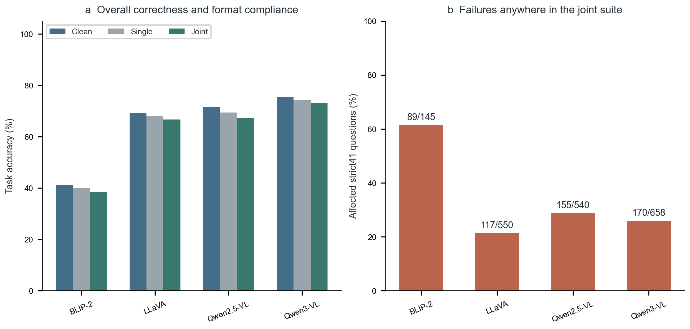
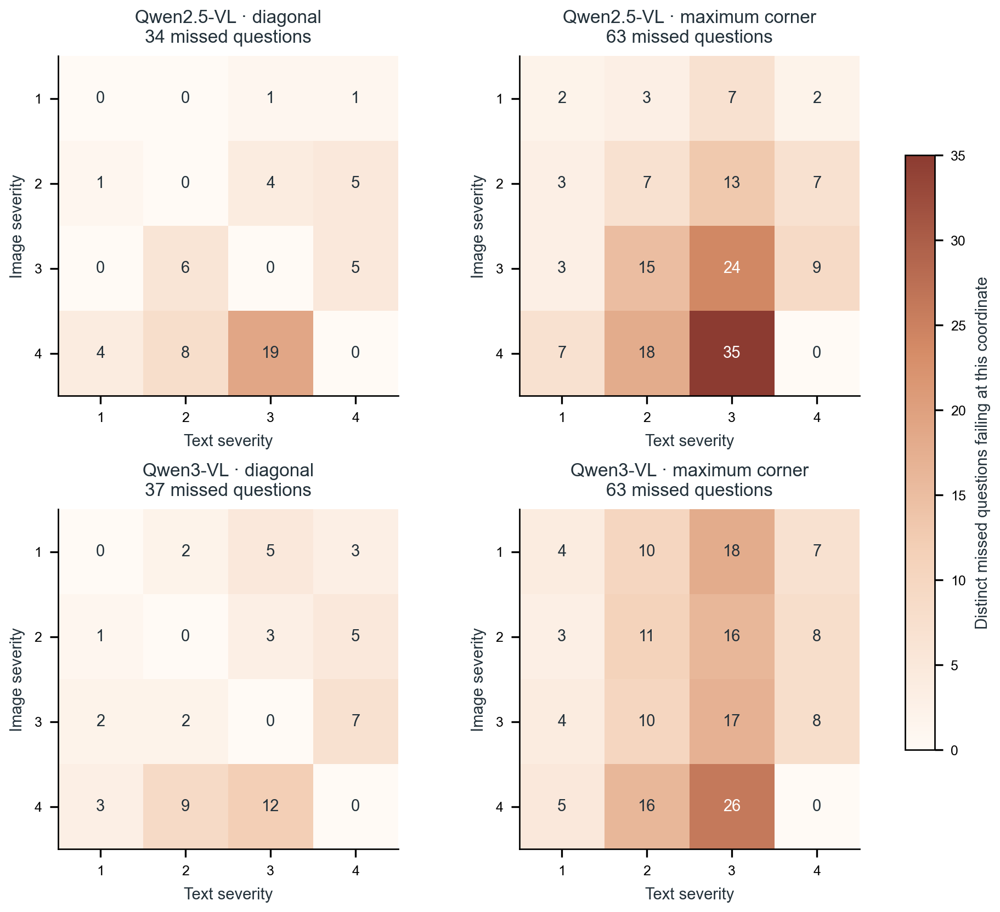
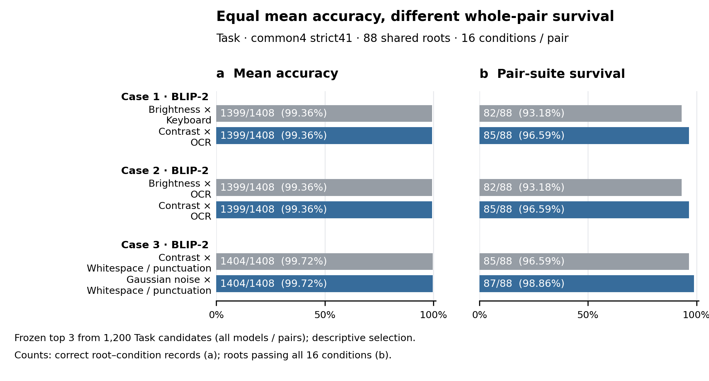

# M³-Test

**Joint-perturbation coverage and preservation of successful VQA behavior**

[中文说明](README_zh.md) · [Current results](docs/BINARY_RESULTS.md) · [Scoring protocol](docs/SCORING.md) · [Reproduction](docs/REPRODUCE.md)

M³-Test follows the same image–question pair through clean, image-only, question-only and joint perturbations. It asks what joint testing reveals after single-modality success, what reduced suites miss, and which previous successes survive a model change.

**Current version, 16 October 2026:** the primary score is `task_pass = semantic_correct AND format_compliant`. Current results and figures use frozen binary judgments. Semantic-only sensitivity is supplied separately with its own qualifications. Earlier EM/F1 code remains available as a **legacy toolkit**, with its original instructions archived under [docs/legacy](docs/legacy/). Those commands do not by themselves reproduce the current binary paper results.

## Evaluation scope

- 1,500 questions from GQA, OK-VQA and VQAv2; 500 questions per source, sharing 1,065 original images.
- Five image and five question perturbation families; four nonzero levels per channel.
- Per question/model: 1 clean + 20 image-only + 20 question-only + 400 joint conditions = **441 condition entries**. Entries need not yield unique strings or pixels.
- BLIP-2 OPT-2.7B, LLaVA-1.5-7B, Qwen2.5-VL-7B and Qwen3-VL-8B: **2,646,000 completed responses regraded under one binary protocol**.
- Compact condition-level labels, image-group identities, source tables, figures and CPU reanalysis are included. Original dataset images, model weights and full raw prediction archives are not bundled; see [released-data scope](docs/RELEASED_DATA.md).

## Main results

All accuracies below require both reference agreement and short-answer format compliance. The strict-41 cohort passes clean and **all 40** single conditions under that row's model. Its denominator differs across models.

| Model | Clean accuracy | Single accuracy | Joint accuracy | Strict-41 questions | Joint-affected questions |
|---|---:|---:|---:|---:|---:|
| BLIP-2 |41.33%|40.00%|38.58%|145|89 (61.38%)|
| LLaVA |69.13%|67.90%|66.63%|550|117 (21.27%)|
| Qwen2.5-VL |71.47%|69.38%|67.28%|540|155 (28.70%)|
| Qwen3-VL |75.60%|74.28%|72.96%|658|170 (25.84%)|

Accuracy denominators per model: clean 1,500; single 60,000; joint 600,000. Conditions and questions sharing an image are correlated observations.



Three observations motivate the protocol:

1. **Sparse events can affect many otherwise successful questions.** Qwen2.5-VL's strict-41 joint failure-event density is 0.514%, while 28.70% of qualified questions fail somewhere. Qwen3-VL's corresponding values are 0.417% and 25.84%.
2. **Maximum corners and diagonals leave coverage gaps.** The 25 maximum corners miss 63 affected questions for each Qwen model. Testing all 100 diagonal cells still misses 34 and 37, respectively. These are different-cost slices of the fixed 400-cell library.
3. **A higher mean does not preserve every previous success.** Of 385 questions passing all 441 conditions under Qwen2.5-VL, 307 remain fully successful under Qwen3-VL; the 78 regressions first appear at clean (10), single (32) or joint (36) testing.



## Paired joint reliability profile

The new [profile analysis](docs/JOINT_METRICS.md) retains both corresponding-single qualification and each question's condition vector. On a fixed four-model intersection:

| Model | JSR | JSS | TGR5 |
|---|---:|---:|---:|
| BLIP-2 |97.562%|41/88 (46.59%)|8.538%|
| LLaVA |99.764%|83/88 (94.32%)|1.172%|
| Qwen2.5-VL |99.325%|78/88 (88.64%)|2.580%|
| Qwen3-VL |99.736%|83/88 (94.32%)|1.170%|

JSR is joint accuracy on **144,754 shared eligible records**, ECR 24.13% of 600,000 records/model. JSS is complete 400-joint survival on a **different shared 88-question/77-image strict41 cohort**. TGR5 averages the worst 20 of 400 supported conditional cell failure rates. Own-qualified results, source/semantic sensitivity, pointwise image-paired intervals and all candidate comparisons are in [results/joint_metrics_v1](results/joint_metrics_v1/). These quantities form a profile, not a weighted universal score.

In a disclosed search of all 1,200 within-model pair comparisons, two BLIP-2 family pairs each answer1,399/1,408 records correctly (99.361%) but preserve complete 16-condition success on 82/88 versus 85/88 questions. Mean accuracy discards that question alignment. JSR is itself conditional accuracy and JSS complements affected-question coverage; TGR/H summarize a conditional map. The added information comes from qualification and retained identities, not new names for redundant formulas.



## Semantic-only sensitivity

Removing the format requirement preserves these findings. Recomputing clean-plus-single qualification using semantic agreement alone gives:

| Model | Semantic-qualified questions | Joint-affected | Diagonal missed | Maximum-corner missed |
|---|---:|---:|---:|---:|
| Qwen2.5-VL |571|170 (29.77%)|39|73|
| Qwen3-VL |659|170 (25.80%)|37|63|

On the **unchanged primary task-qualified** populations, semantic joint failures remain on 152/540 and 170/658 questions. On the unchanged 385-question primary reference-success population, semantic-only replacement still preserves 307. Requalification and fixed-population checks are supplied separately in [semantic results](results/semantic_v1/).

## Reproduce the core counts without a GPU

For all 12 source tables plus the new 18 profile tables and shared 2000-draw image bootstrap:

```bash
python -m pip install -r code/binary/requirements.txt
python code/binary/reproduce_all.py --output output/reproduced --plots
```

`--plots` adds the new profile illustrations; omit it for NumPy-only analysis with `requirements-core.txt`. The released-label replay verifies physical inputs, requires fresh output, reconstructs the tables and checks the historical12CSV values. It does not regenerate model answers or Judge decisions. Earlier publication figures retain their separate plotting entry in [reproduction details](docs/REPRODUCE.md).

The existing PowerShell7.2+ core-count entry also remains available:

```powershell
pwsh -NoProfile -File code/binary/analyze_binary_masks.ps1 -Output ./output/binary-reanalysis
pwsh -NoProfile -File code/binary/test_semantic_sensitivity.ps1
```

The first command reads the included NumPy archive directly through .NET; it does not require Python, NumPy, PyTorch, a model or a Judge. It verifies the release hashes, original image grouping and complete label invariants, then recomputes task/semantic qualifications, slice omissions, corresponding-single gaps and all directed reference-success comparisons. Output must be a new directory.

The publication figures can separately be regenerated from the released source CSVs with the archived Python/matplotlib plotting script. See [reproduction details](docs/REPRODUCE.md) for dependencies, schema, validation and the limits of what is included.

## What the diagnostic measures

- **Strict 41:** clean and all 40 singles pass; count affected questions once and failed joint events separately.
- **Corresponding-single eligibility:** for each joint cell, only its exact image-only and question-only anchors must pass. This does not silently require clean or the other singles to pass.
- **Fixed-reference preservation:** keep the reference population fixed after changing the model; report both wrong→right repairs and right→wrong new failures.
- **Budgets:** the joint-query budget excludes 41 prior qualification queries. Uniform discovery curves are exact expectations on an observed finite grid, not learned-policy generalization.

The separate 200-image, 63,000-response completed adaptation diagnostic is summarized in [current results](docs/BINARY_RESULTS.md). It shows why overall gains and preservation must be reported together; it does not establish an advantage of the additional training constraint.

## Repository map

```text
code/binary/                    current CPU reanalysis and frozen scoring rules
code/run_matrix.py              retained legacy inference/EM/F1 driver
code/infer/, code/route/         retained model adapters and perturbation toolkit
results/binary_v1/              compact full labels, roots, 12 CSVs, current figures
results/semantic_v1/            semantic-only and fixed-primary sensitivity tables
results/expanded_dev_v1/        completed 200-image development summary
docs/SCORING.md                 binary rubric, runtime, qualifications and scope
docs/REPRODUCE.md               executable analysis and legacy distinction
docs/legacy/                   exact previous bilingual README snapshots
```

## Interpretation and data rights

Results describe the recorded perturbation realizations and selected questions. Nominal input strength is not assumed to order model correctness. The Judge sees the original question, reference answers and model prediction, **not the corrupted image**. Semantic sensitivity reuses these judgments; it is not new human validation or proof of corrupted-input answerability. No additional human audit was performed for this release.

This repository reports an evaluation protocol and descriptive findings. It makes no claim of a new state-of-the-art training algorithm, universal causal fusion mechanism or sealed-test/natural-input generalization. Original dataset licenses and access conditions continue to apply. Repository code retains its existing [Apache-2.0 license](LICENSE).

The associated manuscript is in preparation. No journal acceptance or paper DOI is claimed. Until a paper citation is available, cite this repository and the exact commit used.

